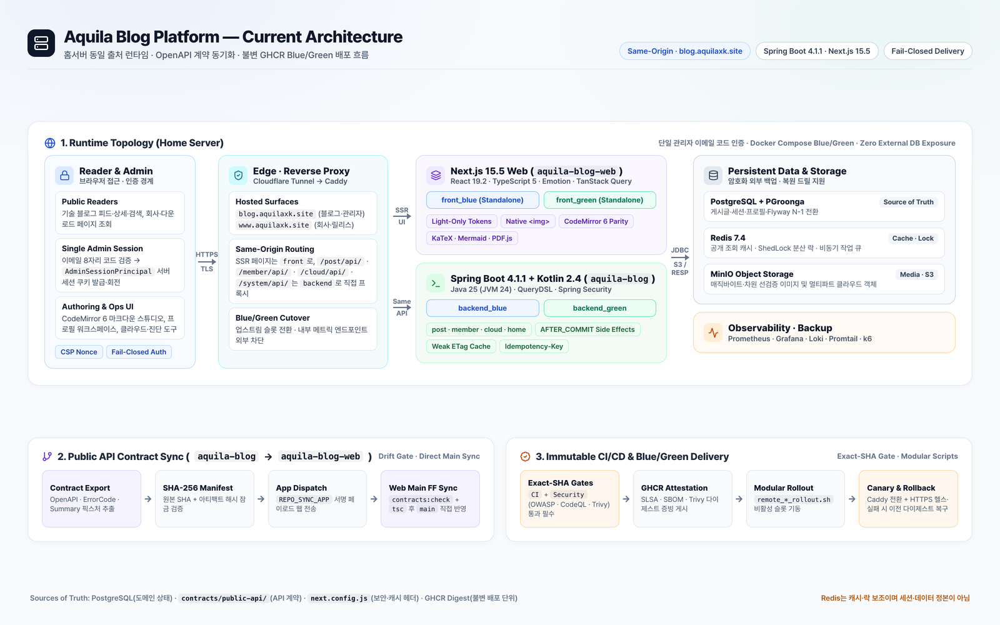

# Aquila Blog Platform

**개인 기술 블로그와 서비스 표면을 뒷받침하는 백엔드 API, OpenAPI 공개 계약, 홈서버 블루/그린 배포 플랫폼**

Aquila Blog Platform은 [blog.aquilaxk.site](https://blog.aquilaxk.site)와 [www.aquilaxk.site](https://www.aquilaxk.site)를 운영하는 백엔드 API, 데이터 계층, 홈서버 인프라를 관리하는 저장소입니다. Spring Boot 4.1.1(Kotlin 2.4.10, Java 25) API 서버와 PostgreSQL(PGroonga), Redis 7.4, MinIO, Caddy 리버스 프록시, 관측·백업 스크립트를 한곳에서 다룹니다.

웹 프론트엔드 UI, 마크다운 에디터 스튜디오, 회사·다운로드 페이지 소스는 [AquilaXk/aquila-blog-web](https://github.com/AquilaXk/aquila-blog-web)이 소유합니다. 이 저장소는 공개 API 계약 정본(`contracts/public-api/`)을 생성해 웹 저장소 `main` 브랜치로 전달하고, 웹 런타임 이미지를 받아 블루/그린 무중단 배포까지 수행합니다.



## 주요 구성

* 백엔드 API(`back/`): `post`, `member`, `cloud`, `home` 경계로 나뉜 모듈과 `AFTER_COMMIT` 후속 처리, Weak ETag 공개 캐시, 단일 관리자 이메일 8자리 코드·서버 세션 인증(`AdminSessionPrincipal`)
* 공개 API 계약(`contracts/public-api/`): OpenAPI 명세·에러 코드·요약 픽스처 정본 생성, SHA-256 매니페스트 검증, `sync-public-contract-to-web.yml` 기반 웹 저장소 `main` 직접 동기화
* 홈서버 무중단 배포(`deploy/homeserver/`): 모듈화된 원격 롤아웃 스크립트(`remote_backend_rollout.sh`, `remote_front_rollout.sh`, `lib/`) 기반 Blue/Green 전환, Caddy 동일 출처 라우팅, 암호화 외부 백업·복원 리허설 및 자동 롤백
* 관측과 부하 시험(`deploy/homeserver/monitoring/`, `perf/k6/`): Prometheus, Grafana, Loki/Promtail 운영 지표·로그 수집과 k6 읽기 경로 부하·카오스 시나리오
* 저장소 가드와 배포 게이트(`tools/`, `.github/workflows/`): 저장소 경계, 추적 금지 파일, 훅 드리프트, 테스트 실행 인벤토리, Flyway N-1 호환성 검사 및 동일 SHA `Security` 통과 후 배포 강제

설계 계약과 운영 런북은 [docs/README.md](docs/README.md), 백엔드 세부 구조는 [back/README.md](back/README.md), 홈서버 보안 점검 항목은 [deploy/homeserver/HARDENING.md](deploy/homeserver/HARDENING.md)에 있습니다.

## 개발하기

```sh
git config core.hooksPath .githooks                                # 저장소 Git 훅 연결
docker compose -f back/devInfra/docker-compose.yml up -d           # 로컬 PostgreSQL·Redis·MinIO 실행
./back/gradlew -p back bootRun                                     # 백엔드 API 실행 (http://localhost:8080)
./back/gradlew -p back exportOpenApiContract                       # 공개 API OpenAPI 계약 생성
```

로컬 실행에는 Java 25 LTS, Node.js 20 LTS, Docker가 필요합니다. 전체 품질·경계 검사는 아래 명령으로 실행합니다.

```sh
./back/gradlew -p back ktlintCheck
./back/gradlew -p back check
bash tools/guards/check-forbidden-tracked-files.sh
node tools/repo-boundary/check-platform-boundary.mjs
node tools/contracts/check-public-contracts.mjs
node tools/ci/verify-test-execution-inventory.mjs
```

## 문제 신고

버그는 [이슈 양식](https://github.com/AquilaXk/aquila-blog/issues/new/choose)으로 신고해 주세요. 기능 요청과 PR은 받지 않습니다. 보안 문제 신고는 [SECURITY.md](SECURITY.md)에 있습니다.

## 라이선스

가져다 쓴 코드의 출처와 라이선스는 [THIRD_PARTY_NOTICES.md](THIRD_PARTY_NOTICES.md)에 있습니다. 블로그 본문과 미디어 콘텐츠([blog.aquilaxk.site](https://blog.aquilaxk.site))는 [CC BY 4.0](https://creativecommons.org/licenses/by/4.0/)을 따릅니다.

License: MIT
